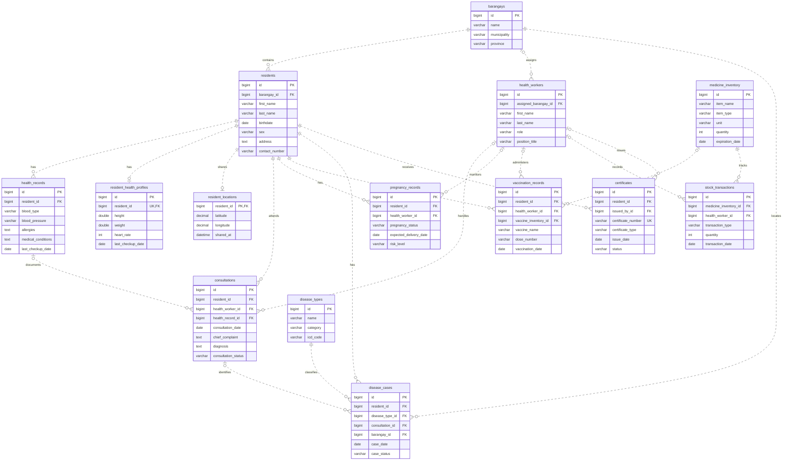

# RHU System: Core Entity Relationship Diagram

This figure shows selected core entities from `database_schema.sql`. It is a simplified logical ERD, not the complete 32-table physical schema. Attributes are selected for readability. PK marks a declared primary key; FK marks an inferred reference, because the supplied SQL does not declare foreign-key constraints. Relationships require confirmation against application behavior before submission.

## Notation

- `||`: exactly one parent.
- `|o`: zero or one parent, based on a nullable reference column.
- `o{`: zero or many child records.
- `o|`: zero or one child record, based on a unique or primary-key reference.
- Dashed lines represent non-identifying relationships, except that the resident location uses its resident reference as its identity; its line is also dashed here to keep this logical overview consistent.

The inferred `vaccination_records.vaccine_inventory_id` reference targets `medicine_inventory`, which includes an `item_type` column. Confirm this mapping in the application. Other reference columns and support modules are omitted from this overview.

## Suggested Figure Caption

Figure X. Core entity relationship diagram of the Rural Health Unit system.

## Suggested Paper Description

The core entity relationship diagram presents the main data structures of the Rural Health Unit system. Barangays group resident records and support health worker assignments. Residents are associated with health records, consultations, pregnancy records, vaccinations, disease cases, and certificates. Each resident may have one health profile and one location record. Medicine inventory supports vaccination references and stock transaction tracking, while disease types classify recorded disease cases. Primary keys identify records, and reference columns associate records across entities.

## Scope

The remaining tables cover audit logs, certificate workflow and approvals, confidential laboratory tests and access logs, dental records, events, FHSIS reports, portal content and settings, notifications, push subscriptions, sanitary records, and vital statistics. Include these in separate module diagrams or a full appendix ERD if required by the capstone format.
